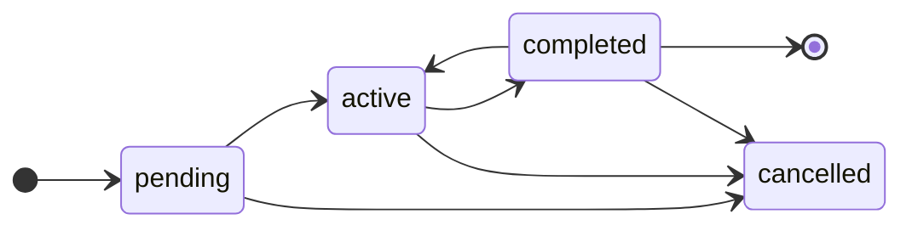
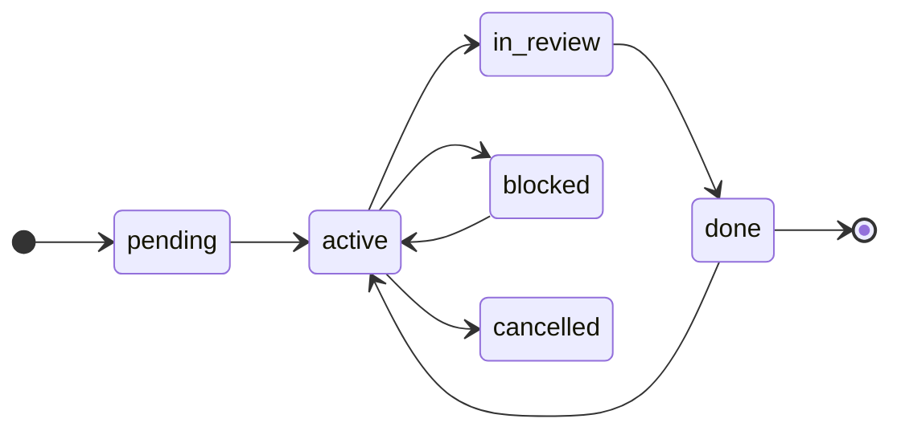

# Task Lifecycle

Los directorios `.claude/plans/` y `.claude/tasks/` gobiernan cómo se descompone,
se sigue y se cierra el trabajo en este repo. Esta guía es la **referencia
canónica** para humanos y agentes. Cualquier desviación se motiva y se registra en
el **Registro de cambios** del plan afectado.

> Este fichero lo materializa la skill `/plan-task` (plugin `task-pipeline`) desde su
> plantilla. Ajústalo a las particularidades del repo (lista de packages, runner
> de tests, comandos) pero conserva el esqueleto: estados, ramas, gates y DoD.

> **Adaptado a ESTE repo** (source del plugin `task-pipeline`):
> - **Rama de integración = `main`** (no hay `dev`). Las ramas de feature son `plan/<package>/<name-plan>`
>   y se cortan **desde `main`**.
> - **Stack = `none`** (entregables: Markdown + Bash). Los comandos concretos que aparecen abajo
>   (`pnpm test`/`lint`, Stryker, TSDoc, `pnpm changeset`) son **N/A aquí**; la verificación es por
>   **inspección / `grep` / `test -d` / correr la skill o el hook**. Los ítems de **TDD** y **gate de
>   mutation** de la DoD no aplican; **`fact-checker`** y los dos checkpoints humanos **sí**.

## Configuración del repo (`.claude/task-pipeline.yml`)

Algunas fases del pipeline son **opcionales y configurables por repo** en
`.claude/task-pipeline.yml`. Las skills lo leen y lo respetan. **Resolución**:
defaults internos (= preset `full`) → preset de `mode:` → claves explícitas en
`stack:`/`features:`. **Sin archivo → todo `full`** (comportamiento histórico).

**`mode:`** fija los defaults de las features:

| `mode` | `tdd` | docs | `mutation-gate` | Para |
|---|---|---|---|---|
| `full` (default) | ON | ON | `80` | repos con stack de tests sano |
| `legacy` | ON | ON | OFF | legacy: testeas lo que tocas, pero no llegas a 80 |
| `docs-only` | OFF | ON | OFF | solo orquestar planes + documentar |

**`stack:`** (`language`, `package-manager`, `test-runner`, `mutation-tool`): las
skills eligen comandos con esto en vez de asumir pnpm/Vitest/Stryker. En monorepos
poliglotas, `stack.packages.<pkg>` pisa el stack por-workspace (herencia parcial: solo
las claves que declara); la **regla de resolución canónica** vive en el README del plugin
→ "Configuración por repo" → "Stack por-package".

**`features:`** (una clave explícita pisa el preset):

| Flag | Valores | Controla |
|---|---|---|
| `features.tdd` | `true`/`false` | Exigir tests/TDD (1 test por escenario) en la DoD. |
| `features.closing-documentation.tsdoc` | `true`/`false` | Doc en el código en la DoD. |
| `features.closing-documentation.technical-docs` | `true`/`false` | Doc técnica (README/CLAUDE.md/specs/ADRs). |
| `features.closing-documentation.context-log` | `true`/`false` | Session log en `.claude/context/`. |
| `features.mutation-gate` | `false`/`true`(=80)/`<int>` | Gate de mutation y su umbral `break`. |
| `features.caveman` | `off`(default)/`lite`/`full` | **Comportamiento** opt-in (no gate de DoD): comprime el output del hilo principal (hook `UserPromptSubmit`), con backoff en checkpoints. No forma parte de ningún preset; valor no-canónico → `off`. |
| `features.github-tracking` | bloque; opt-in (default `off`) | **Comportamiento** opt-in (no gate de DoD): proyección one-way md→GitHub (plan→issue padre, tarea→sub-issue). **No** forma parte de ningún preset; su **ausencia no es drift** para `/doctor`. Solo `enabled: true` activa; valor no-canónico → off. |
| `features.sdd` | `false`(default)/`true`/bloque `{ enabled, provider }` | **Comportamiento** opt-in (no gate de DoD salvo con el flag on): capa **SDD** (spec EARS + CU Gherkin + ADR MADR). **Fuera de todo preset**; fail-safe (cualquier valor no canónico → off; reglas en «Modo SDD»); **ausencia ≠ drift**.  Modos `off`/`native`/`external`: ver [Modo SDD](#modo-sdd-off--native--external). |
| `features.conventional-commits` | `true`(default)/`false` | Formato `<task-id>: <conventional commit>`. Comportamiento histórico, configurable; `false` lo relaja. **Ausencia = ON**. |
| `features.git-automation` | bloque; opt-in (default `off`) | **Comportamiento** opt-in: `auto-commit` (cierre de tarea), `auto-pr` (cierre de **plan**; requiere `auto-commit`), `co-author` (default off). **Fuera de todo preset**; fail-safe; **ausencia ≠ drift**. |

Una capa/gate desactivada deja de ser obligatoria: no entra en la DoD ni bloquea
el cierre. **Los dos checkpoints humanos (`grilling` y la aprobación del plan) NO
son configurables** — son por diseño.

> **`features.github-tracking`** (proyección opcional a GitHub Issues) tiene su guía completa —setup,
> config, mapeo plan→padre / task→sub-issue, ciclo de vida del padre, límites y riesgos aceptados— en el
> README del plugin → [GitHub tracking (opcional)](../../task-pipeline/README.md#github-tracking-opcional).

La sección `models:` fija el modelo de las fases con subagente: **3 siempre** (`design-review`,
`scenario-coverage`, `fact-checker`) **+ `sdd-lint`**, condicional al modo nativo (`sdd: true`). Ver [Routing de
modelo por fase](../../task-pipeline/README.md#routing-de-modelo-por-fase-models) en el README del plugin.

### Modo SDD: `off` / `native` / `external`

> **Regla única.** Esta sección es la **única** definición de cómo se resuelve `features.sdd`; el resto del
> plugin (skills, `doctor`, `task-init`, README, portal) la **enlaza**, no la repite.

`features.sdd` se resuelve a uno de tres modos. **Fail-safe**: ante la duda, `off`.

| Valor de `features.sdd` | Modo |
|---|---|
| `true` (booleano) | `native` |
| bloque con `enabled: true` (booleano) **y** `provider` string **no vacío** (tras trim) | `external` |
| cualquier otra cosa | `off` |

«Cualquier otra cosa» incluye: `false`, ausente, `null`/vacío, `"true"` (string), `yes`, `[true]`; bloque sin
`enabled` o sin `provider`; `enabled` no booleano (`"true"`) o `false`; `provider` vacío, solo espacios, `null`,
número o lista. Las **claves extra** dentro del bloque se toleran (`/doctor` las señala como posible typo).
**YAML ilegible** → `off` con aviso de config ilegible, sin invocar a ningún provider. Un `provider` que
resuelve a una skill del propio `task-pipeline` se **rechaza** con aviso → modo efectivo `off`: es el que lleva el
prefijo `task-pipeline:` (p.ej. `task-pipeline:plan-task`) **o** un nombre **sin `:`** que coincide con una de sus
skills (`task-init`, `plan-task`, `mutation`, `doctor`, `grilling`, `design-review`, `scenario-coverage`,
`fact-checker`, `pipeline-usage`, `sdd-lint`). El `provider` se trata como **un único identificador**, nunca como argumentos
(`"spec:run phase=close"` es un solo nombre, no dos).

- **`native`** — la capa SDD descrita en «Flujo SDD» (spec EARS + CU Gherkin + ADR MADR, gate `sdd-lint`).
  Equivalente en comportamiento al previo a `external`, salvo: una tarea que ya enlaza a un CU sigue ese enlace en
  cualquier modo, la línea de DoD de `external` es no aplicable en nativo y la cat. 13 de `/doctor`.
- **`external`** — el SDD lo gestiona un plugin externo (`provider: "<plugin>:<skill>"`). Lo **nativo se
  apaga**: sin plantillas ni scaffolding SDD, sin gate `sdd-lint` ni efecto de `models.sdd-lint`, y el Gherkin
  vuelve a vivir en la tarea. Lo único que sobrevive: **si una tarea ya enlaza a un CU, ese enlace se sigue
  siempre**, sea cual sea el modo. El pipeline **invoca la skill del provider** al arrancar la tarea y al
  cerrarla; el contrato (versión 1, **experimental**) y la semántica de avisos están en el CU
  [`sdd-proveedor-externo`](../../.claude/specs/task-pipeline/casos-de-uso/sdd-proveedor-externo.md).
- **`off`** — sin capa SDD; el Gherkin vive en la tarea.

> **Los schemas son ayuda de editor, no validación.** `task-pipeline.schema.json` acepta `provider: ""` y
> `{ enabled: true }` (sin provider) por ser válidos como tipos, pero en runtime ambos resuelven a `off`. No
> hay parser: el modelo interpreta el YAML con esta tabla.

## Layout de directorios

```
.claude/
  plans/
    pending/<package>/<name-plan>.md
    active/<package>/<name-plan>.md
    completed/<package>/<name-plan>.md
    cancelled/<package>/<name-plan>.md
  tasks/
    pending/<package>/<task-id>.md
    active/<package>/<task-id>.md
    completed/<package>/<task-id>.md
    cancelled/<package>/<task-id>.md
  context/<package>/<task-id>.md      # session log — append-only
  specs/<package>/HOW-TO-START-A-TASK.md
```

- `<package>` es el nombre de un workspace del repo.
- `<name-plan>` es kebab-case **sin sufijo numérico ambiguo** (p.ej.
  `bootstrap-foundation`, **no** `phase-01`): el `<task-id>` lo embebe y debe poder
  separarse de forma inequívoca (ver abajo).
- `<plan-id>` es **`<package>-<name-plan>`** (p.ej. `api-bootstrap-foundation`). Único
  por plan y ya conocido por `/plan-task`.
- `<task-id>` es **`<plan-id>-<nn>`** (p.ej. `api-bootstrap-foundation-01`), donde
  `<nn>` es un **correlativo DENTRO del plan desde `01`** — el **último segmento de 2
  dígitos** del id. **NO es un contador global del package**: el espacio de nombres del
  id coincide con la unidad de paralelismo (plan = rama), de modo que dos planes
  distintos nunca generan ids que colisionen. Estable para siempre, aunque cambie la
  prioridad.
  - **Parseo inequívoco (por qué `<name-plan>` no acaba en número)**: como el id es
    `<plan-id>-<nn>` y `<nn>` son los **2 últimos dígitos**, un `<name-plan>` acabado en
    número lo hace irrecuperable — `name-plan = phase-01` daría `api-phase-01-01`, donde
    no se distingue si el plan es `phase` (tarea `01-01`) o `phase-01` (tarea `01`).
  - **Formato de `<nn>`**: 2 dígitos con cero a la izquierda desde `01` (`01`, …, `09`,
    `10`). A partir de la tarea **100** pasa a 3 dígitos (`100`), manteniendo el ancho
    fijo dentro de un tramo para preservar el orden lexicográfico.
  - **Coherencia `plan:` ↔ `id`**: el campo `plan:` del frontmatter de la tarea es el
    `<name-plan>` y **debe coincidir** con el `<name-plan>` embebido en el `id`.
  - **Convivencia con ids legacy**: los ids ya creados con el **esquema anterior**
    (`<package>-<nnn>`, contador global del package — en este repo, `task-pipeline-001`
    …`task-pipeline-012`) son estables y **no se renumeran**; conviven con los nuevos
    ids plan-scoped (histórico mixto de ids opacos). El esquema nuevo aplica solo a
    planes/tareas nuevos.

La carpeta es un índice; el `status:` del frontmatter es la fuente de verdad.
**Nunca muevas un fichero sin actualizar `status:`, ni actualices `status:` sin
mover el fichero** — son una sola operación conceptual.

## Plantilla de plan

```markdown
---
id: <package>-<name-plan>
package: <package>
status: pending          # pending | active | completed | cancelled
branch: plan/<package>/<name-plan>
created: YYYY-MM-DD
updated: YYYY-MM-DD
---

# <Título del plan>

## Contexto y problema
## Objetivos                  # cada uno con su *criterio de éxito* observable
## Alcance y fuera de alcance
## Recursos externos
## Estimación global
## Criterios de calidad y verificación
## Tasks
- [ ] `<plan-id>-01` (P1) — <título corto>  · depends_on: —
- [ ] `<plan-id>-02` (P2) — <título corto>  · depends_on: <plan-id>-01

## Registro de cambios del plan
- YYYY-MM-DD: creado
```

## Plantilla de tarea

````markdown
---
id: <plan-id>-<nn>        # <plan-id> = <package>-<name-plan>; <nn> correlativo del plan desde 01 (2 díg.)
package: <package>
plan: <name-plan>         # = <name-plan> embebido en id (deben coincidir)
status: pending          # pending | active | blocked | in-review | done | cancelled
priority: 1
depends_on: []
estimate: 2h
actual:
created: YYYY-MM-DD
updated: YYYY-MM-DD
---

# <Título de la tarea>

## Description
## Spec
## Fuera de alcance
<!-- Heredado del `### Fuera de alcance` del plan: los bullets que acotan ESTA tarea. Si el plan no
     lo tiene, está vacío, o la tarea se crea sin plan → `—` explícito, nunca el placeholder crudo.
     Acota el encargo, no el esfuerzo: lo que sí está dentro se termina entero. -->
## Scenarios (Gherkin)
<!-- Cada escenario es la fuente 1:1 de un test TDD — el `Then` es el assert.
     Cubre camino feliz Y bordes/errores (el mutation testing los exige). Si la
     tarea no produce código testeable, justifícalo aquí y di cómo se verifica. -->
```gherkin
Feature: <capacidad bajo esta tarea>

  Scenario: <caso concreto>
    Given <precondición>
    When <acción>
    Then <resultado observable y verificable>

  Scenario: <error / borde>
    Given ...
    When ...
    Then <error esperado, código, efecto>
```
## Provides
<!-- Contrato hacia abajo: qué deja disponible para las tareas que dependen de esta
     (su superficie/API/ficheros nuevos). NO un resumen de los `Then` del Gherkin.
     Si nada depende de esta tarea, pon "—". -->
## Definition of Done
- [ ] Tests escritos ANTES de la implementación (TDD) — Red → Green → Refactor  · solo si `features.tdd`
- [ ] Cada escenario Gherkin tiene al menos un test (camino feliz + bordes/errores)  · solo si `features.tdd`
- [ ] Todos los tests en verde
- [ ] Spec cumplida; lo declarado en `Provides` queda disponible para las dependientes
- [ ] Lint / format / typecheck OK
- [ ] Gate de mutation testing superado **con la herramienta del package** (`stack.mutation-tool`; Stryker verificado, `mutmut`/`mutation-command` como referencia)  · salvo `features.mutation-gate: false`
- [ ] **Gate `sdd-lint` superado** — artefactos SDD sin **ERROR** de formato/completitud (AVISO se reconoce); tras `mutation`, antes de `fact-checker`  · solo en modo nativo (`sdd: true`)
- [ ] **SDD gestionado con `<provider>`** — provider invocado (`phase=close`) tras `mutation`, antes de `fact-checker` (siempre se invoca; «sin cambios» solo describe lo que el provider reportó, en el session log); con la línea `provider phase=close: <resultado>` en el session log; un aviso sin reconocer deja la línea sin marcar  · solo en modo `external`
- [ ] Gate de `fact-checker`: afirmaciones de la sesión verificadas (INCORRECTO bloquea) — tras mutation, antes de commit/resumen  · no-negociable, sin flag
- [ ] Proyección de estado a GitHub aplicada al cerrar (issue → `done`/close) — best-effort, no bloquea el `.md`  · solo si `features.github-tracking`
- [ ] **SDD**: spec (EARS) + caso de uso (Gherkin) creados/actualizados en la tarea, **o** declarado "sin cambios de spec/CU" (checkbox + session log); el Gherkin vive **solo en el CU**  · solo en modo nativo (`sdd: true`)
- [ ] Documentación — tres capas (TSDoc + doc técnica + histórico)  · cada capa según `features.closing-documentation.*`
- [ ] Docs de dev / usuario final + `pnpm changeset` donde aplique
````

> Las líneas de TDD, gate de mutation y documentación se rigen por
> `.claude/task-pipeline.yml` (preset `mode` + flags): una fase desactivada se omite
> de la DoD. Sin el archivo (o en `full`), todas son obligatorias.
>
> **Líneas de DoD de otro modo SDD.** Las líneas «solo en modo nativo» y «solo en modo `external`» se evalúan
> contra el modo **vigente al cerrar**, no contra el de la creación de la tarea. Si el modo cambió, **las del otro
> modo no aplican** y aplican las del modo vigente: nativo → `external` (la línea `sdd-lint` y la de spec/CU dejan de
> aplicar; aplica «SDD gestionado con `<provider>`») y `external` → nativo (la línea del provider deja de aplicar;
> aplican spec/CU, o «sin cambios de spec/CU», y el gate `sdd-lint`). Nunca se marca una línea que no aplica.

La skill `/plan-task` copia estas plantillas (sus ficheros completos `plan.md` /
`task.md`) al crear cada plan/tarea. No las re-inventes por sesión.

## Crear un plan

> La skill `/plan-task` orquesta todo este flujo (plan mode → plan en `pending/` →
> `grilling` → `design-review` → tareas Gherkin → `scenario-coverage` → handoff TDD
> → gate de mutation). Al terminar entrega **sola** el prompt de arranque de la
> primera tarea. Los pasos de abajo son lo que sigue, y lo que haces tú si lo conduces a mano.

1. Redacta el plan con la plantilla.
2. Corre la skill `grilling` antes de aprobar para sacar huecos, supuestos ocultos
   e ítems inviables (rama por rama). Itera hasta que el plan sobreviva al interrogatorio.
   Solo se preguntan **decisiones** que cambien el plan: nada que el código o la propia petición
   ya respondan, ni verificaciones de implementación.
3. Corre la skill `design-review`: un subagente fresco revisa el plan COMO UN TODO
   (coherencia, tamaño correcto, mantenibilidad, escalabilidad real, reversibilidad).
   Ajusta el plan con los hallazgos.
4. Tras la aprobación del owner: deja el plan en `.claude/plans/pending/<package>/`,
   `status: pending`.
5. Descompón en tareas. Cada tarea cabe en un commit lógico / una sesión.
6. Corre la skill `scenario-coverage`: un subagente QA fresco endurece los escenarios
   Gherkin del set de tareas por dimensiones (fronteras, errores, estado, requisitos
   ausentes…). Incorpora los huecos aceptados.
7. Rellena la sección **Tasks** del plan: lista ordenada y consciente de
   dependencias.

> `grilling` (paso 2) y la aprobación (paso 4) son **no negociables**. `design-review`
> y `scenario-coverage` (pasos 3 y 6) corren por defecto pero admiten un **salto solo en
> planes triviales**: una sola decisión replicada, sin contrato nuevo ni decisión
> arquitectónica (y, para `scenario-coverage`, 1 tarea sin caminos de error reales).
> Lo confirma el owner **una vez por pasada** (aceptar una no arrastra la otra), se
> registra en el Plan change log y caduca si una re-planificación rompe los criterios.
> Nunca un salto silencioso; sin canal para preguntar, la pasada se ejecuta. Los
> criterios completos, con su frontera resuelta por ejemplo, están en la skill `plan-task`.

## Arrancar un plan

1. Mueve el plan a `.claude/plans/active/<package>/`, `status: active`, bump `updated`.
2. Abre la rama de feature **desde la rama de integración** (en este repo, **`main`** — no hay `dev`):

   ```bash
   git switch main
   git pull
   git switch -c plan/<package>/<name-plan>
   ```

   Todas las tareas del plan caen en esta rama. Al cerrar el plan, se mergea a la
   rama de integración por PR.
3. **(Opcional, `features.github-tracking`)** si el plan tiene `issue:`, proyecta el arranque del **padre**:
   campo **Status del Project → `In progress`** (best-effort). El padre **no** recibe label `status:*` ni
   assignee. Si `gh` falla, avisa y sigue; el `status:` del plan **no** se bloquea.

> **Trabajo en equipo / colisiones de id.** El `<task-id>` es plan-scoped precisamente para que
> **rama = plan** no genere colisiones al mergear. El porqué, el residual honesto (mismo `<name-plan>` /
> dos ramas del mismo plan) y **cómo resolver una colisión** están en la guía de equipo del README del
> plugin → [Trabajo en equipo y colisiones de id](../../task-pipeline/README.md#trabajo-en-equipo-y-colisiones-de-id).
> `/doctor` la detecta (categoría "ids de tarea/plan duplicados").

## Arrancar una tarea

1. Comprueba que todas las `depends_on` están en `done`.
2. Mueve la tarea a `.claude/tasks/active/<package>/`, `status: active`, bump `updated`.
3. Abre el session log en `.claude/context/<package>/<task-id>.md` con la primera entrada.
4. **Solo una tarea por plan puede estar `active`** — comparten rama.
4b. **(Solo modo `external`)** invoca la skill del provider con `contract=1 phase=start task=<ruta> plan=<ruta>`
   **tras** mover la tarea a `active` (las rutas son relativas a la raíz y existen). **Solo en la activación `pending → active`**
   (`blocked → active`, cancelar y la reapertura `done → active` no invocan). El `provider` se pasa como **un único identificador**; `plan=` va vacío con
   aviso si no hay plan legible. **Relee la tarea** al terminar: el provider puede haberla modificado. Si el
   provider no está instalado, falla o no responde → **aviso que el owner reconoce** (nota en el session log); la
   tarea arranca igualmente y la línea de DoD del SDD queda sin marcar. Contrato y semántica en [`sdd-proveedor-externo`](../../.claude/specs/task-pipeline/casos-de-uso/sdd-proveedor-externo.md).
5. **(Opcional, `features.github-tracking`)** si la tarea tiene `issue:`, proyecta el arranque a su issue
   (best-effort): campo **Status del Project → `In progress`**, label **`status: in-progress`** (recipe
   add-then-remove) y **assignee** según la clave `assignee` (ver la tabla completa y el recipe en "Cerrar
   una tarea"). Si `gh` falla, avisa y sigue; el cambio de `status:` del `.md` **no** se bloquea.

> Cada tarea es una conversación/sesión nueva. Las sesiones futuras reconstruyen
> el contexto exclusivamente desde el task file + el session log.

## Trabajar una tarea

- TDD obligatorio (si `features.tdd`, default): test que falla primero, luego la implementación mínima, luego refactor. En `legacy`/`docs-only` con `tdd: false`, no se exige.
- SOLID, Clean Code y los patrones que apliquen — no negociable.
- **Documenta sobre la marcha**: todo símbolo público lleva **TSDoc** al escribirlo
  (no al final). La doc nunca es un afterthought.
- Commits en la rama del plan con `<task-id>: <conventional commit>`.

## Cerrar una tarea

Una tarea es `done` solo cuando **todos** los checkboxes de su DoD son ciertos. En
particular:

1. Todos los tests en verde (`pnpm --filter <pkg> test` o repo-wide `pnpm test`).
2. Lint / format / typecheck OK (`pnpm lint`).
3. **Gate de mutation testing superado** con la **herramienta del package**
   (`stack.mutation-tool`: Stryker verificado; `mutmut`/`mutation-command` como referencia
   con banner) sobre los ficheros que tocó la tarea — salvo que `features.mutation-gate` sea
   `false`. `features.mutation-gate` **no** es per-package (solo `stack.*` lo es). Survivors por
   debajo del umbral = tests/aserciones que faltan (a menudo un escenario Gherkin sin
   assert real) → refuerza los tests hasta matarlos. Ver la skill `/mutation`.
3b. **Gate `sdd-lint`** (solo en modo nativo, `sdd: true`): **entre** el gate de mutation y `fact-checker`, corre
   la skill `sdd-lint` sobre los artefactos SDD (spec EARS / CU Gherkin / ADR MADR). Un **ERROR** de
   formato/completitud **bloquea** el cierre hasta corregir (como `fact-checker` `INCORRECTO`); un **AVISO**
   se reconoce, no bloquea. En modo `off` o `external`, **no corre**. Ver la skill `/sdd-lint`.
3c. **Invocación del provider `phase=close`** (solo modo `external`): ocupa el **hueco de `sdd-lint`** — **tras**
   `mutation`, **antes** de `fact-checker`, del auto-commit y de la proyección a GitHub (así lo que genere el
   provider entra en el commit de la tarea). Se invoca `contract=1 phase=close task=<ruta> plan=<ruta>` **antes**
   de mover la tarea a `completed` (la ruta existe). Se invoca **al llegar a ese hueco**, no antes: si falla un paso
   previo de la DoD (tests, lint/typecheck o `mutation` si está activo) **no se invoca**. Sin gate de mutation
   (`features.mutation-gate: false` o `stack.mutation-tool: none`) el hueco sigue a lint/tests. Se **reintenta** tras un
   fallo posterior y se **vuelve a invocar** tras una reapertura `done → active` (el provider debe ser idempotente).
   **Rastro**: al invocar, añade al session log una línea `provider phase=close: <resultado>` (`ok`, `aviso`,
   `ausente` o `error`); un reintento añade una línea nueva (append-only). Terminar sin error ni reporte = OK; **sin respuesta o sin
   canal** para un provider interactivo = error del provider. Provider ausente o con error → **aviso que el owner
   reconoce** (nota en el session log); lo que el provider reporta sobre sus artefactos se traslada como **aviso,
   nunca ERROR** (el pipeline no valida su contenido). La línea de DoD «SDD gestionado con `<provider>`» queda sin
   marcar hasta reconocerlo: el pipeline la señala y **no cierra en silencio**, pero el cambio de `status:` del
   `.md` **no se bloquea**. Releer la tarea tras la invocación.
4. **Gate de `fact-checker`** (no-negociable — sin flag que lo desactive, como
   `grilling`/aprobación): **tras** el gate de mutation y **antes** de commit y del
   resumen final, corre `fact-checker` sobre las afirmaciones factuales de la sesión
   (incluida «el gate de mutation pasó» y, en modo nativo, «el gate `sdd-lint` pasó»; en modo `external`, que existe la
   última línea `provider phase=close:` del session log, **autodeclarada**: prueba que se anotó, no que el provider
   corriera; sin ella es `NO VERIFICABLE`, no `INCORRECTO`). `INCORRECTO` **bloquea** el cierre hasta
   corregir la afirmación; `NO VERIFICABLE` es un **aviso a reconocer** explícitamente
   (frecuente en repos sin runner de tests), pero no bloquea; `VERIFICADO` pasa. Aplica
   en cualquier preset (`mode`/`features` no lo tocan). Ver la skill `/fact-checker`.
5. **Documentación actualizada** — tres capas (cada una obligatoria salvo que su flag
   en `features.closing-documentation.*` sea `false`), más dev/usuario donde aplique:
   - **TSDoc en el código** (`tsdoc`): cada símbolo público con su comentario
     (intención, params, returns, errores).
   - **Doc técnica / contexto** (`technical-docs`): README del package, `CLAUDE.md`
     del workspace, `.claude/specs/`, ADRs para decisiones de arquitectura.
   - **Histórico de la tarea** (`context-log`): el session log (paso 6).
   - **Dev / usuario final** (donde aplique): onboarding, guías, scripts,
     `.env.example`, mensajes de error, entrada de `pnpm changeset`.

   Si la tarea no tiene superficie de usuario, el session log lo justifica.
6. Session log cerrado con: resumen, decisiones técnicas + porqué, tests corridos +
   resultado, docs actualizadas (rutas + motivo), ficheros/commits, tiempo real,
   follow-ups.
7. Mueve la tarea a `.claude/tasks/completed/<package>/`, `status: done`, rellena
   `actual:`, bump `updated`.
8. Marca el `[x]` en la sección **Tasks** del plan y bump el `updated` del plan.
9. **Siguiente paso, sin que lo pidan** (último ítem del cierre, tras el resumen final):
   - **Quedan tareas** → entrega el **prompt de arranque de la siguiente** (la primera por orden con todas
     sus `depends_on` en `done`), en bloque de código y autocontenido: id de tarea y de plan, rutas a leer
     (este lifecycle, el `HOW-TO-START-A-TASK.md`, el plan, la tarea) y "Arrancar una tarea". Si ninguna
     está desbloqueada, di qué la bloquea.
   - **Era la última del plan** → no hay siguiente prompt: **pregunta (`AskUserQuestion`) si se quiere el
     code review del plan y con qué modelo** (Opus · Sonnet · Haiku · no). Si acepta: subagente fresco con
     ese modelo sobre `git diff <integración>...plan/<package>/<name-plan>`, hallazgos sin filtrar y
     decisión con el owner, **antes de abrir la PR** (ver "Cerrar un plan"). Sin canal para preguntar, no
     se ejecuta: se deja indicado como pendiente.

El session log es append-only y vive solo en `.claude/context/<package>/<task-id>.md`.
Es el registro canónico; no lo dupliques.

> **Flujo SDD (solo modo nativo, `sdd: true` — opcional).** Con SDD `off` (default) o `external` nada de esto
> aplica: el Gherkin vive en el `## Scenarios` de la tarea (salvo que ya enlace a un CU: ese enlace se sigue
> siempre). Con el modo nativo:
>
> - **Fuente única del Gherkin = el caso de uso.** El `## Scenarios (Gherkin)` de la tarea **enlaza** al/los
>   CU (`.claude/specs/<pkg>/casos-de-uso/<id>.md`) en vez de copiar el bloque. Anti-duplicación: **ADR** =
>   *por qué* · **Spec (EARS)** = *qué* · **CU (Gherkin)** = *cómo + criterios de aceptación*.
> - **DoD gated**: la tarea no cierra sin **crear/actualizar** la spec (EARS) + el CU (Gherkin) que toca,
>   **o** declarar **"sin cambios de spec/CU"** en el **checkbox de la DoD** y una línea del **session log**
>   (no en el CU).
> - **Bootstrap del primer spec/CU**: si el package aún no tiene `spec.md`/CU, la sesión **lee
>   `templates/spec.md` y `templates/caso-de-uso.md` con `Read` y los materializa** en las rutas canónicas
>   **antes** de enlazarlos (mismo estilo imperativo que `/task-init`).
> - **`scenario-coverage` retro-alimenta el CU**: los escenarios endurecidos se incorporan al **CU** (fuente
>   única), no como copia divergente en la tarea. **`/mutation`** sigue el enlace al CU al leer survivors.
> - **Enlace roto**: si el `## Scenarios` enlaza a un CU inexistente/borrado, **repórtalo** — no asumas "sin
>   escenarios" en silencio.
> - **Convivencia / toggle a mitad**: las tareas materializadas **antes** de activar el flag (Gherkin inline)
>   **conviven** con las nuevas y **no se migran a la fuerza**; la regla aplica a las tareas **nuevas** desde
>   que el flag está on.

> **Git automation — auto-commit (opcional, `features.git-automation.auto-commit`).** Con el flag **off**
> (default) el commit de cierre es **manual**, exactamente como hoy. Con **on**: al llegar aquí (DoD en
> verde, incluido `fact-checker`), la sesión ejecuta automáticamente `<task-id>: <mensaje>`.
> - **Formato del mensaje**: respeta `features.conventional-commits` — ON (default) = `<task-id>:
>   <conventional commit>`; `false` = `<task-id>: <mensaje libre>`.
> - **Trailer de co-autor**: se añade **solo** si `git-automation.co-author: true` (default **false** = no lo
>   añade). Gobierna los commits de la **automatización**, no los manuales (esos los rige tu `CLAUDE.md`).
> - **Best-effort**: si el commit falla (git error), **avisa** y **no** bloquees el cambio de `status:` del
>   `.md` (el `.md` manda).

> **Proyección de estado a GitHub (opcional — `features.github-tracking`).** Solo si el flag está
> `enabled` **y** la tarea tiene `issue:` (sin `issue:` → ciclo de vida **local puro**, ni un comando
> `gh`; tampoco dispara un `create` — eso es Paso 5.7 de `/plan-task`). One-way, **best-effort**,
> idempotente desde el `.md`. Al cambiar `status:` el estado se proyecta en **dos sitios**: el **campo
> Status del Project** y una **label `status:*`** en la propia issue.
>
> | Transición | Status del Project | label `status:*` | Issue |
> |---|---|---|---|
> | → `active` (arranque) | `In progress` | `status: in-progress` | + assignee (ver clave `assignee`) |
> | → `in-review` | `In review` | `status: in-review` | — |
> | → `blocked` | (queda en `In progress`) | `status: blocked` | — |
> | `blocked` → `active` (desbloqueo) | `In progress` | `status: in-progress` | — |
> | → `done` | `Done` | (retirar `status:*`) | `gh issue close` |
> | → `cancelled` | `Done` | (retirar `status:*`) | `gh issue close --reason "not planned"` |
> | `done` → `active` (reapertura) | `In progress` | `status: in-progress` | `gh issue reopen` |
>
> **Familia de labels** — `status: in-progress` · `status: blocked` · `status: in-review` (crear con
> `gh label create` si faltan — "ya existe" **no** es fallo; colores sugeridos in-progress `FBCA04`,
> blocked `B60205`, in-review `0E8A16`; descripción `(task-pipeline)`).
>
> **Recipe idempotente (add-then-remove)**: al entrar en un estado, **añade primero** la label nueva y
> **después** retira las demás `status:*` **y la label `blocked` PELADA legacy** (esquema anterior — el
> recipe la migra, o quedaría pegada sin auto-cura). Así un fallo parcial **sobre-etiqueta** (se auto-cura
> en la siguiente transición) en vez de dejar la issue **sin** estado. En `done`/`cancelled` se retiran
> **todas** las `status:*`.
>
> **Assignee** (solo la sub-issue de la tarea; lee la clave `features.github-tracking.assignee`): `@me`
> (default) = identidad `gh` que arranca; un **login** para fijar otro; **`false`** para no asignar. Con
> `gh issue edit --add-assignee` (acumula, no reemplaza; no se desasigna al cerrar). Si el assignee **no
> es colaborador asignable** → avisa y sigue.
>
> **Match del Status case-insensitive** por nombre (`In progress` real ≠ el `In Progress` que a veces
> escriben los docs); si el Project del consumidor **no tiene** la opción esperada → **salta el Status +
> avisa** (la label `status:*` es el fallback visible).
>
> **El body NO se re-vuelca** en transiciones (design-review #3): solo se tocan Status/label/assignee. El
> re-vuelco del body vive en la **re-proyección explícita** (`/doctor` / re-run de `/plan-task`).
>
> **Idempotencia**: cerrar una issue ya cerrada es **no-op** (no error); re-proyectar el estado actual no
> duplica label ni assignee. **Degradación (C3)**: si `gh` falla / sin red / el Project no tiene la opción
> esperada → **avisa y NO bloquees** el cambio de `status:` del `.md` (el `.md` manda; el drift
> `.md`↔label↔Project es **residual aceptado** que se re-alinea al re-proyectar). El cierre de la issue
> **PADRE** del plan y la concurrencia viven en "Cerrar un plan".

## Cerrar un plan

1. Al cerrar la última tarea:
   - **Code review del plan** (ofrecido en el paso 9 de "Cerrar una tarea"): si el owner lo aceptó, se
     hace **antes** de abrir la PR.
   - Plan → `completed`: mover a `.claude/plans/completed/<package>/`, `status: completed`, bump `updated`.
   - **(Opcional, `features.github-tracking`)** si el plan tiene `issue:`, proyecta el cierre del **padre**:
     campo **Status del Project → `Done`** y `gh issue close` — GitHub **no** la auto-cierra al cerrar las
     sub-issues. El padre **no** lleva label `status:*` ni assignee. Best-effort (C3): si `gh` falla / sin
     red → **avisa y NO bloquees** el cierre del plan (mover a `completed/`, `status:`).
   - Abre PR desde `plan/<package>/<name-plan>` a la rama de integración. **Tests
     en verde y docs al día** son obligatorios antes del merge.
   - **(Opcional, `features.git-automation.auto-pr`)** con `auto-pr` **y** `auto-commit` on, la sesión abre
     esta PR **automáticamente** al cerrar la última tarea; `auto-pr: true` con `auto-commit: false` =
     **inerte** + aviso. Best-effort: si `gh`/la PR falla, avisa y **no** bloquees el cierre del plan. Con el
     flag off (default), la PR es **manual** como hoy.
   - Borra la rama tras el merge.
2. Los releases se cortan con **tags SemVer sobre `main`** (`v<x.y.z>`), en ciclos de release, no al cerrar un plan.
3. Añade una nota retro al plan cerrado: estimación vs. real, sorpresas, dependencias
   no vistas.

## Estados y transiciones

| Entidad | Estados | Notas |
|---|---|---|
| Plan | `pending → active → completed` | `cancelled` desde cualquier estado. `completed → active` es la **reapertura** (antes de mergear la PR) y se registra en el Registro de cambios. |
| Tarea | `pending → active → in-review → done` | `blocked` desde `active` (motivo en el session log) → vuelve a `active` al desbloquear. `cancelled` desde cualquier estado. |

**Plan:**



**Tarea** (`blocked` y la reapertura `done → active` son transiciones laterales):



## Re-planificación, bloqueos, cancelación

- Plan obsoleto a mitad → para, corre `grilling` sobre las tareas afectadas,
  ajusta / añade / cancela, registra todo en el **Registro de cambios** del plan.
  No empujes sobre un plan incorrecto.
- Tarea bloqueada → `status: blocked` + motivo en el session log; ninguna otra tarea
  del plan pasa a `active` hasta resolverlo.
- Tarea cancelada → mover a `cancelled/`, `status: cancelled`, registrar motivo.
  Revisa los dependientes.

## Mejora continua

Cada plan cerrado recibe una nota retro comparando `estimate` vs `actual`, las
dependencias no vistas y qué hacer distinto. La calibración mejora estimaciones
futuras y reduce ciclos de `grilling`.
