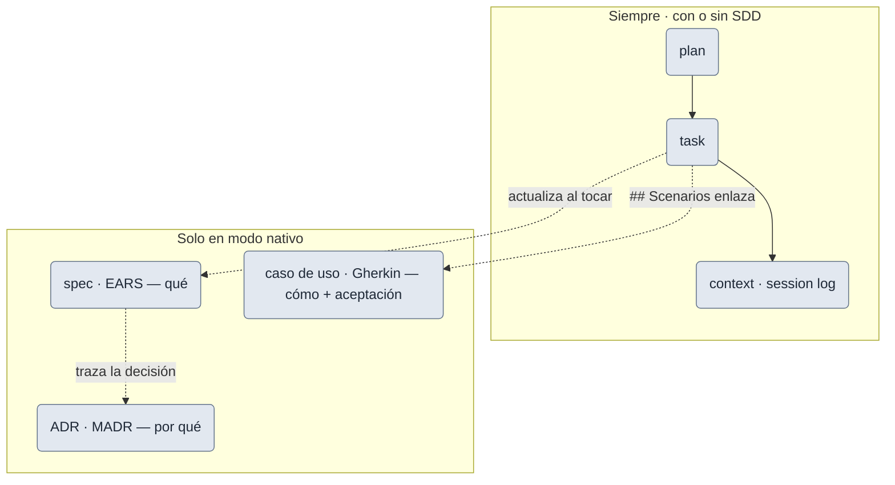
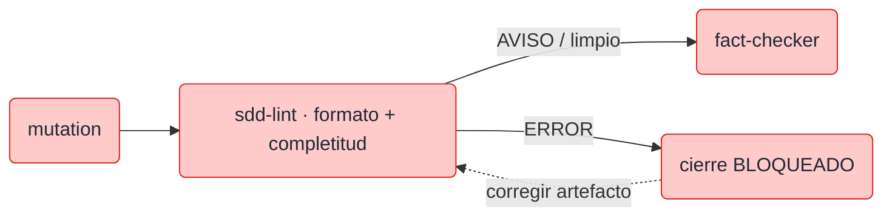
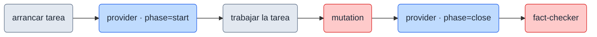

# SDD: nativo o externo (opcional)

Capa **opt-in** (default `off`) de **Spec-Driven Development**: eleva la fuente de verdad de la prosa en
`docs/` a artefactos **vivos** —**spec** de requisitos (EARS), **casos de uso** (Gherkin) y **ADR** (MADR
4.0.0)— que cada tarea mantiene. Puede ser **nativa** (la capa del plugin) o **externa** (delegada en otro
plugin de SDD).

## Los tres modos

`features.sdd` se resuelve a `off`, `native` o `external`. La regla —tabla y casos límite— está escrita una
sola vez en la
[guía de ciclo de vida → "Modo SDD"](https://github.com/drossan/claude-plugins/blob/main/docs/guides/task-lifecycle.md#modo-sdd-off--native--external); aquí solo el resumen:

| Modo | Cómo se activa | Qué hace |
|---|---|---|
| `off` (default) | ausente, `false` o cualquier valor no canónico | Sin capa SDD; el Gherkin vive en la tarea. |
| `native` | `sdd: true` | Capa nativa del plugin (el resto de esta página). |
| `external` | bloque `{ enabled: true, provider: "<plugin>:<skill>" }` | Lo nativo se apaga; el pipeline invoca la skill del provider. |

## Activar

En `.claude/task-pipeline.yml`:

```yaml
features:
  sdd: true    # modo nativo · false (default) = off
```

Para el modo externo, ver [SDD externo](#sdd-externo-provider).

## Qué envía

**Plantillas, no contenido** (nada se autogenera): las semillas `spec.md`, `caso-de-uso.md`, `adr.md` y
`adr-index.md`, que se materializan en:

- `.claude/specs/<pkg>/spec.md` — requisitos (user stories P1/P2/P3 + EARS + criterios `SC-00x`).
- `.claude/specs/<pkg>/casos-de-uso/<id>.md` — casos de uso (Cockburn + **el Gherkin de aceptación**).
- `.claude/specs/adr/NNNN-*.md` + `adr-index.md` — decisiones de arquitectura (MADR 4.0.0, `NNNN` desde
  `0001`, sin `ADR-0000` de relleno).

## El flujo, con y sin SDD

Lo que **no cambia**: el bucle `plan → task → context` y los checkpoints/gates del pipeline son los mismos.
Lo que cambia es **dónde vive la fuente de verdad** de requisitos, decisiones y escenarios.

| | Sin SDD (default) | Modo nativo (`sdd: true`) |
|---|---|---|
| **Gherkin de aceptación** | en la tarea (`task.md`) | en el **caso de uso**; la tarea `## Scenarios` **enlaza** (no copia) |
| **Requisitos** | prosa del plan / `docs/` | **spec** viva — EARS (*qué*) |
| **Decisiones** | plan / mensaje de commit | **ADR** — MADR (*por qué*) |
| **Cierre de tarea** | `mutation → fact-checker` | + gate **`sdd-lint`** entre ambos |
| **DoD** | — | *gated*: no cierra sin actualizar spec + CU que toca, **o** declarar "sin cambios de spec/CU" |

Con el modo nativo, los tres artefactos se reparten el trabajo sin duplicarse, alrededor del mismo bucle:



<small>gris = artefacto. Anti-duplicación: **ADR** = *por qué* · **Spec (EARS)** = *qué* · **CU (Gherkin)** = *cómo + aceptación*.</small>

- **Fuente única del Gherkin = el caso de uso.** `scenario-coverage` y `/mutation` **siguen el enlace al CU**:
  la QA retro-alimenta el CU; el bucle de survivors localiza el escenario en el CU, no en la tarea.
- **Enlace roto** → se reporta (no se asume "sin escenarios"). **Toggle a mitad**: las tareas inline previas
  **conviven** y **no se migran a la fuerza**; la regla aplica a las tareas nuevas.

## Garantías opt-in

- **Fail-safe**: ante la duda, **off**, sin error de parseo. La tabla de resolución (qué valores dan `native`,
  `external` u `off`, incluido el rechazo de un provider del propio pipeline) vive solo en
  [Modo SDD](https://github.com/drossan/claude-plugins/blob/main/docs/guides/task-lifecycle.md#modo-sdd-off--native--external).
- **Fuera de todo preset**: `mode: full` **no** lo enciende; es una decisión explícita.
- **Ausencia ≠ drift**: `/doctor` no reporta la falta del flag ni de las plantillas SDD salvo que el flag
  esté **on en modo nativo** (en `external` no hay plantillas SDD que reportar) (mismo criterio que `caveman`/`github-tracking`).
- **Off = equivalente en comportamiento al de antes de existir `external`**: sin el flag, el Gherkin vive en la
  tarea (`task.md`), salvo que la tarea ya enlace a un CU (ese enlace se sigue siempre). El modo nativo es
  equivalente con dos salvedades más: la línea de DoD de `external` no aplica y la cat. 13 de `/doctor` detecta el lifecycle anterior a la regla de modos.

## Gate de validación (`/sdd-lint`)

En modo nativo, al **cerrar una tarea** (entre `/mutation` y `fact-checker`) corre `sdd-lint`: valida **formato +
completitud** de los artefactos — EARS bien-formado, estado MADR coherente, disciplina Gherkin, `[NECESITA
ACLARACIÓN]` sin resolver, enlaces/trazabilidad. **ERROR bloquea** el cierre; **AVISO** se reconoce.



<small>rojo = gate de cierre.</small>

Invocable a mano (`/sdd-lint [package]`) para auditar, y con un **helper Bash opcional**
(`scripts/sdd-lint.sh`) que un repo con CI puede cablear para validación desatendida.

## SDD externo (`provider`)

Para repos que ya usan **otro plugin de SDD**:

```yaml
features:
  sdd:
    enabled: true
    provider: "mi-plugin:mi-skill"   # un único identificador <plugin>:<skill>
```

Con `external`, **lo nativo se apaga**: sin plantillas ni scaffolding SDD, sin gate `sdd-lint` ni efecto de
`models.sdd-lint`, y el Gherkin vuelve a la tarea (si una tarea ya enlaza a un CU, ese enlace se sigue
siempre). El pipeline **invoca la skill del provider** con `contract=1 phase=start|close task=<ruta>
plan=<ruta>`: `start` al arrancar la tarea y `close` al cerrarla, entre `mutation` y `fact-checker`.



<small>azul = skill del provider · rojo = gate de cierre · gris = paso.</small>

- **Contrato v1, experimental**: puede cambiar entre versiones y aún no se ha validado contra un provider real.
- **Avisar, no bloquear**: provider no instalado, con error o sin respuesta → **aviso que el owner reconoce**
  (nota en el session log); lo que el provider reporta se traslada como aviso, **nunca ERROR** — el pipeline
  no valida su contenido.
- **Idempotencia**: `close` se reintenta tras un fallo posterior o una reapertura, así que el provider debe ser idempotente.
- **Riesgos conocidos**: la config viaja con el repo y el provider se invoca sin confirmación; revisa el
  `task-pipeline.yml` entero de un repo ajeno. Lista completa en el
  [README del plugin](https://github.com/drossan/claude-plugins/blob/main/task-pipeline/README.md#sdd-nativo-o-externo-opcional).
- `/task-init` y `/doctor` ofrecen nativo vs externo con confirmación explícita; el cambio de nativo a
  externo es manual y no migra ni borra artefactos nativos.

Contrato completo y degradación: [README del plugin → SDD](https://github.com/drossan/claude-plugins/blob/main/task-pipeline/README.md#sdd-nativo-o-externo-opcional).

## Profundizar (opcional)

El flujo SDD paso a paso está en la
[guía de ciclo de vida → "Flujo SDD"](https://github.com/drossan/claude-plugins/blob/main/docs/guides/task-lifecycle.md);
el detalle formal de EARS/MADR/Gherkin, en el
[README del plugin → SDD](https://github.com/drossan/claude-plugins/blob/main/task-pipeline/README.md#sdd-nativo-o-externo-opcional).
